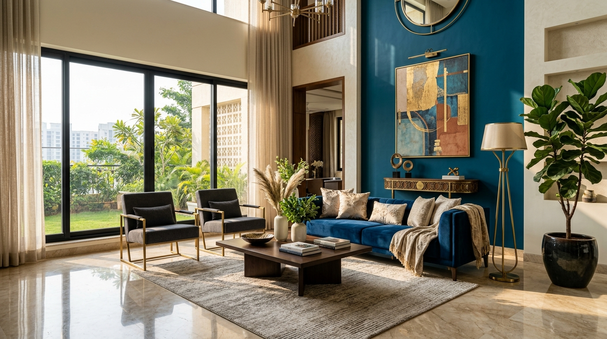

# Asian Paints Authorised Dealership Website

A modern, responsive, high-converting business website for an authorised **Asian Paints Dealership** in India. Built with React 19, TypeScript, Tailwind CSS v4, and Lucide icons.



---

## ✨ Features

- 🏛️ **Official Authorised Dealership Branding:**
  - Clear authorised status badge & disclaimers (does not falsely claim corporate headquarters).
  - Genuine factory-sealed packaging assurance and in-store computerized tinting highlights.
- 🎨 **Interactive Colour Inspiration Studio:**
  - Dynamic SVG room visualizer for **Modern Living Room**, **Bedroom**, and **Exterior Villa Facade**.
  - Live wall painting for **Main Wall**, **Accent Feature Wall**, and **Ceiling/Trim**.
  - Curated Asian Paints designer palettes (*Modern Peacock Haven*, *Warm Jaipur Terracotta*, *Serene Botanical Sanctuary*, etc.) with authentic shade codes (e.g. 7394, 0514, 8093).
  - 1-click WhatsApp enquiry with selected shades.
- 🪣 **Complete 8 Product Categories Catalog:**
  - Interior Wall Paints (Royale Luxury, Apcolite Premium, Tractor, Royale Glitz)
  - Exterior Wall Paints (Apex Ultima, Apex Weatherproof, Ultima Protek, Ace)
  - Premium Emulsions (Royale Matt, Royale Aspira, Royale Shyne, Royale Health Shield)
  - Waterproofing Solutions (SmartCare Damp Block 2K, SmartCare HydroLoc, Crack Seal)
  - Wood Finishes (WoodTech Italian PU, Aquadur, Touchwood)
  - Metal Paints & Primers (Apcolite Gloss Enamel, Rust Shield, Decoprime Red Oxide)
  - Painting Tools & Accessories (TruCare Rollers, Brushes, Precision Masking Tapes)
  - Putty & Surface Preparation (TruCare Acrylic Wall Putty, 2-in-1 Wall Leveler, WT Primer)
  - Real-time search bar & category filter tabs.
  - Detailed **Quick View Modal** with specs, washability, coverage, and available pack sizes.
- 📐 **Paint Quantity Estimator / Calculator:**
  - Space presets (*1 Room*, *1 BHK*, *2 BHK*, *3 BHK*, *Villa Exterior*, *Custom*).
  - Calculates net paintable area (sq. ft.), required emulsion paint (litres), primer (litres), and wall putty (kg).
  - 1-click send estimate to WhatsApp for bucket sizing (20L, 10L, 4L, 1L).
- 💬 **WhatsApp Lead Generation System:**
  - Always-visible floating WhatsApp button with live status ping.
  - Comprehensive enquiry form with validation (Customer Name, 10-digit mobile, Category, Project type, Area, Message).
  - Pre-filled message generator for direct store communication.
- 📍 **Store Location & Contact Section:**
  - Store address, landmark, weekly & Sunday business hours.
  - Google Maps directions link & interactive map embed.
- ⚙️ **Central Configuration File:**
  - All dealership details, contact numbers, address, and timings can be edited in one single file: `src/config/dealershipConfig.ts`.

---

## 🛠️ Tech Stack

- **Framework:** React 19 + TypeScript
- **Bundler & Dev Server:** Vite 8
- **Styling:** Tailwind CSS v4
- **Icons:** Lucide React
- **Typography:** Google Fonts (Outfit & Plus Jakarta Sans)

---

## 🚀 Getting Started

### Prerequisites

- Node.js (v18+)
- npm or yarn

### Installation

```bash
# Clone the repository
git clone https://github.com/shrestsoni28-ops/asian-paints.git
cd asian-paints

# Install dependencies
npm install

# Start development server
npm run dev
```

Open `http://localhost:5173/` in your browser.

### Building for Production

```bash
npm run build
```

---

## 📝 Customizing Dealership Details

Edit `src/config/dealershipConfig.ts` to update:
- Store Name
- WhatsApp Number
- Phone Numbers
- Showroom Address & Landmark
- Business Hours
- Google Maps Link

---

## 📄 Disclaimer

This website is developed for an independent authorised dealer of Asian Paints products. All trademarks, brand names, product logos (including Asian Paints, Royale, Apex, Tractor, SmartCare, WoodTech, TruCare) belong to Asian Paints Ltd.
